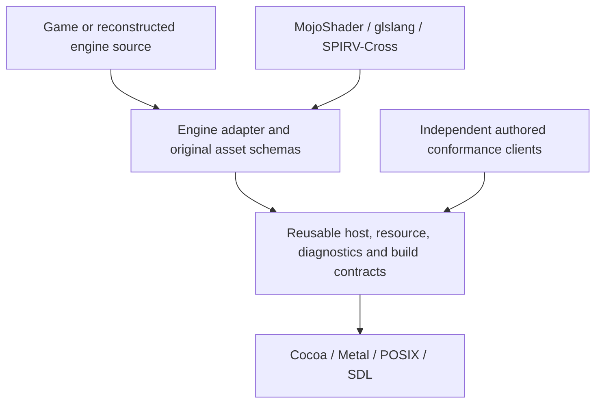

# Optimization and reusable porting toolkit audit

MAC324, 2026-10-28. Baseline: delivered 0.1.4/build320, public source
`178ffbbf35c448e0cd2d52776c925bf41e583fb6`. Three read-only graphics, CPU/audio
and startup/platform audits informed this report. Findings below identify work;
they do not establish new speed, memory or power savings. The delivered game
and its production sources remain unchanged by this audit.

## Evidence and measurement gaps

The final build already passes both 148-test suites, actual left-Control LAN
hosting and actual human WASD race/exit acceptance. These are correctness
results, not a current resource-usage census. MAC323's minimal diagnostics do
not provide GPU execution time, allocation counts, memory high-water marks or
per-frame percentiles.

Earlier comparable 2560x1440 moving windows improved from 48.35 to 65.09–66.03
submitted presents/second after texture-mirror and bounded-presentation work.
These are historical engine-submission observations, not displayed FPS, a
measurement of build320 or an independent gain for each repair. Another early
window still recorded p99 63.415ms and maximum 288.956ms. See
[the evidence and contrary results](remaining-audio-jitter.md).

Current MetalTrace records CPU spans/waits, not GPU execution. Aggregate update
timing cannot distinguish physics, AI, animation, streaming, job assistance or
several fixed simulation ticks. Allocator/process memory and GPU/staging storage
also need separate accounting: unified memory numbers must not simply be added
and reported as independent physical RAM.

First add bounded, opt-in counts and timing for native state creation, PSO/MSL
misses, encoder restarts, upload/snapshot bytes, update subphases, jobs/locks,
allocation domains and resource high-water marks. Observe GPU timing only after
existing completion, without adding a synchronous wait. Use the existing common
clock and overflow reporting for CPU records. GPU timestamps have their own
documented host-time domain: report end-minus-start durations first and
correlate epochs only after validating a mapping to CPU `steady_ns`. Apple's GPU tools and optional
[Tracy](https://github.com/wolfpld/tracy) can supply maintained profiling tools;
Tracy is a candidate, not an integrated dependency.

## Ranked optimization work

Order reflects boundedness and source evidence, not predicted percentage gain.
Every candidate below still needs a current benchmark.

| Priority | Concrete opportunity | Source evidence | Quality/ownership contract and validation |
| --- | --- | --- | --- |
| 1 | Reuse immutable depth/stencil states | [`MetalContext.mm::draw`](../../code/mercury/library/graphics/display2/source/device/metal/MetalContext.mm) creates descriptors and `newDepthStencilState` for every draw; `clearRectangle` also creates states | Cache exact effective settings, including missing attachments; stencil reference remains dynamic. Alternate depth/stencil/clear/MSAA states and verify pixels. Count native creations and CPU encoding before/after. |
| 2 | Avoid reading DDS image data twice | [`MetalImageLoading.cpp::LoadDDS`](../../code/mercury/library/graphics/display2/source/device/metal/MetalImageLoading.cpp) reads/validates all bytes then deletes them; [`Utils.cpp::CreateTexture2DFromFile`](../../code/mercury/library/graphics/display2/source/utils/Utils.cpp) reopens and streams all mips | Retain validated input through upload with exact format/mip offsets and tight-to-aligned rows. Preserve secure PAK authentication, malformed-input rejection and cleanup. Compare file/decompression bytes, pixels, cold/warm loading time and peak RAM. A retained file buffer is a memory tradeoff to measure. |
| 3 | Reuse draw-preparation scratch storage | `MetalContext.mm::draw` creates vectors/lock lists and scans indexed ranges; packed vertices and triangle fans add conversion storage | Begin with context-owned bounded scratch; preserve sorted lock acquisition and every bounds/format check. Derived-data caches require content generations across writes, discard, copy and aliases. Measure allocations/scanned bytes and test invalid inputs and concurrent ownership. |
| 4 | Cache compiled shaders and first-use pipelines across sessions | [`MetalShaders.mm`](../../code/mercury/library/graphics/display2/source/device/metal/MetalShaders.mm) calls `newLibraryWithSource`; `MetalContext.mm::pipeline` compiles on an in-memory PSO miss | The existing PSO cache already handles in-session reuse. A persistent cache needs full source/translation/options/device/OS/compiler identity, bounded storage and corruption fallback. Measure compilation counts/time and cold versus warm launch/first lap. Keep reflection and failure reporting. |
| 5 | Avoid render-encoder endings for unchanged bindings | `SetColourSurface` and `SetDepthStencilSurface` end an encoder even when binding the same storage | Count redundant bindings first. Preserve slot-zero viewport/scissor resets, actual attachment aliases, query segments, resolves, feedback snapshots and clears. Compare real GPU time and exact authored pixels. Do not change load/store policy without proving each consumer. |
| 6 | Batch tiny texture uploads and compatible snapshot copies | [`C_Surface::UnlockRect`](../../code/mercury/library/graphics/display2/source/device/metal/MetalSurfaces.mm) submits per-subresource uploads; car light cubes update six faces; colour-feedback snapshots allocate/copy faces and mips | Preserve staging ownership through completion and binding-time snapshot versions. Reuse only retired compatible storage, with explicit bounds. Measure command count, copied bytes and peak live resources. Keep cross-queue/map/error/lifetime tests; do not remove waits globally. |
| 7 | Reduce repeated allocation-domain discovery | `AllocatorFunctions.inl` free paths repeatedly classify ownership/size; an older sample contains `BizInternalFree`/`malloc_size` stacks | Check emitted optimized code and current call counts. Reuse classification within one operation while preserving malloc/SBA/aligned ownership, tracking and late-thread frees. Process-lifetime metadata is intentional; reclaiming it early previously caused failures. |
| 8 | Avoid repeated audio-arena and startup-registry scans | Audio `StaticBufferAllocator` already preallocates 50 blocks but scans from zero; native named-object creation sweeps the weak registry | Measure actual batch/name counts first. Preserve exhaustion, alignment, Flush-before-reuse, live-name sharing and expired-name recreation. These are not evidence of per-batch heap allocation or ordinary mutex-enter cost. |
| 9 | Remove unchanged developer shader rebuilds | `blur_mac_authored_shaders` is always run; `compile_shaders.py` deletes and regenerates selected outputs | Cache by source plus transitive includes, defines, manifest and compiler identities; publish outputs atomically and preserve generated bytes. Test no-op/invalidation/failure builds. This improves development CPU/time, not game FPS. |

The DDS candidate needs an explicit native upload path: the existing in-memory
switch in `Utils.cpp` lacks L8 while its native streamed path supports it. Simply
retaining `m_pFileData` would regress L8 assets such as `ghost_mask.dds`. Preserve
that format and all mip/row-pitch validation in the regression matrix.

The first candidate follows Apple's recommendation to reuse immutable native
state objects: [Metal persistent objects](https://developer.apple.com/library/archive/documentation/3DDrawing/Conceptual/MTLBestPracticesGuide/PersistentObjects.html).
Persistent compilation can use the platform's
[binary-archive facility](https://developer.apple.com/documentation/metal/creating-binary-archives-from-device-built-pipeline-state-objects).
Neither reference proves a gain in this particular game.

Scheduler completion locking and SDL device/queue queries are additional
measurement candidates. The scheduler lock protects group/event retirement;
deleting it would reverse a correctness repair. Audio metadata caching must
handle device changes and keep queued/usable frames fresh. Neither justifies
changing priorities, queue lengths, sample rates, DSP or simulation cadence.

For each experiment, pin actual pixel dimensions, graphics settings, track,
vehicle/AI count, audio format and executable/dependency hashes. Separate cold
and warm tests; qualify actual human-race state and fixed-tick counts. Compare
main critical-path and GPU execution timing, frame tails, CPU time, wakeups and
memory high-water marks. Worker spans overlap and cannot be summed into claimed
wall-time savings. Keep profiled attribution runs separate from quiet timing
runs. Test the original archive/effect/render path with sound muted. Preserve
resolution, shaders, shadows, effects, physics, AI count and audio quality.

## What abstraction exists today

The port adapts an existing Mercury/Amax engine. Its useful seams include:

| Existing component | Reusable content | Remaining coupling |
| --- | --- | --- |
| `Framework::Mac::Window` | Cocoa lifecycle, Retina backing pixels, physical input events, CAMetalLayer access and callback failure/lifetime handling | Public `Core.h` scalar aliases, Mercury namespace, Blur class/title defaults; current target links the core runtime |
| `Audio::Mac::Playback` | SDL stream lifecycle, per-stream mute, device-period/queue status and bounded diagnostics | `Core.h` aliases and engine diagnostic policies; the original mixer/decoder graph remains game-specific |
| Display2 Metal backend | GPU resources, command ownership, state translation and conformance fixtures | Mercury public types, D3D9-style states/register banks, BMSL reflection, engine vertex formats and game-derived shader conventions |
| Native thread/file/ABI services | Darwin/POSIX bridges and tests for concrete legacy semantics | Engine allocator/global runtime contracts; process-local named objects do not implement every Windows IPC feature |
| Shader/build/package tooling | Translation, reflection, dependency bundling, manifests and integrity checks | Jam/CP manifests, engine semantic rewrites, executable/notice names and Homebrew provenance assumptions |
| Game/application adapter | PC data schemas, asset mounting, game controls, layer/view resize publication and save/network rules | Intentionally belongs to this game/engine; it is not a generic host service |

The [current CMake graph](../../cmake/macos.cmake) links `blur_mac_display2_metal`
to `blur_mac_engine_system`; `blur_mac_window` links
`blur_mac_core_runtime`. Existing authored GPU/window fixtures also use engine
headers. An independent installed SDK with a stable generic API has not been
demonstrated. A PImpl implementation boundary alone does not establish one.

The standalone `NativePakArchive` inspector is used by bootstrap/probe/tests.
Actual gameplay mounts original archives through `GameSystems`, `PakFs` and
`PakEntryFile`; optimizing the inspector would not optimize that startup path.

## Proposed reusable toolkit

Scope: help developers port source-available games or reconstructed engines to
native macOS. Each engine still needs an adapter. Games sharing the same engine
can reuse more; a different engine still brings different data, shader, lifetime,
physics and middleware contracts. Arbitrary Windows executables also require
Windows ABI/API and potentially instruction-set compatibility, which this port
does not implement.

Keep host OS, runtime ABI, renderer and asset schema independent. A configuration
can be macOS + arm64/LP64 + Metal while reading fixed-width little-endian PC
assets. Native addresses need pointer-sized types; serialized 32-bit fields
must stay 32-bit when their format requires it. Blanket Windows-to-Mac macro
replacement would recreate earlier porting faults.

Practical extraction sequence:

1. Define contracts and provenance for a small host package. The narrowest
   current custom component is the Cocoa window/event/Metal-layer host. Replace
   public engine scalar dependencies with standard fixed-width types and retain
   main-thread, reentrancy, focus, Retina and exception contracts. The host emits
   focus changes; held-key release belongs to the input adapter consuming them.
   For an engine
   already using SDL, reuse SDL directly instead of imposing another window API.
2. Consume an installed CMake package from a separate authored client with no
   Mercury/Blur include paths or assets. Exercise rendering, fixed simulation
   ticks with interpolation, async-creation resize, physical modifiers,
   focus-loss releases, callback exceptions and clean shutdown. This proves an
   independent host client, not another complete game port.
3. Extract common-clock diagnostics, shader-cache/build and packaging contracts;
   parameterize game-specific names and manifests. Publish supported features,
   unsupported behavior and bounded resource/lifetime conformance tests.
4. Make Blur consume the same package through its engine adapter. Retain the
   full existing test/actual-game acceptance and verify another clean Mac.
5. Port a second actual engine/game through a second adapter before advertising
   broad conversion savings. Keep game schemas and inherited engine code in
   adapters; publish independently authored toolkit modules and upstream notices
   with explicit file provenance rather than relabeling the whole engine.

## Existing projects to build upon

- [SDL3](https://www.libsdl.org/) already supplies maintained platform/audio/input
  facilities. The present port uses its audio output; other adapters can use
  more of SDL instead of cloning those services.
- [MojoShader](https://github.com/icculus/mojoshader), glslang and
  [SPIRV-Cross](https://github.com/KhronosGroup/SPIRV-Cross) are already the shader
  foundations. Our engine register/reflection glue is the separate adapter.
- [bgfx](https://bkaradzic.github.io/bgfx/overview.html) and
  [wgpu](https://github.com/gfx-rs/wgpu) provide existing portable rendering APIs,
  including Metal. They are alternatives for future source-engine adapters;
  replacing the working Blur renderer would require a new fidelity project,
  not establish an optimization by itself.
- [DXVK Native](https://github.com/doitsujin/dxvk#dxvk-native) can support native
  source-port bring-up through a Vulkan implementation of legacy D3D.
  [MoltenVK](https://github.com/KhronosGroup/MoltenVK) maps a Vulkan portability
  subset to Metal. Neither provides the entire Windows runtime or automatically
  solves a game's asset/ABI dependencies. Neither is integrated here.

Immediate recommended implementation milestone: instrument and qualify exact
depth/stencil-state reuse, then the DDS single-read path. In parallel, specify
and validate one independent host-package client before starting a wider SDK.

## Implemented milestone (MAC330/334)

The user approved both bounded optimizations and the independent host client.
They are now implemented and qualified in complete Debug/Speed 151-test suites,
GPU differential/read-count controls and muted actual-game driving/normal exit.
NativeHost installs/relocates independently; its separate find_package Metal
demo runs without engine headers or game assets. This establishes the host
package milestone, not a second full-engine adaptation. Actual timing evidence
is mixed and does not support a repeatable FPS-gain claim. See
[the acceptance report](optimization-host-acceptance.md) for all results and
[the authored SDK](../../code/mercury/library/gamesys/framework/native_host/README.md)
for the scoped API, license and integration boundary.
